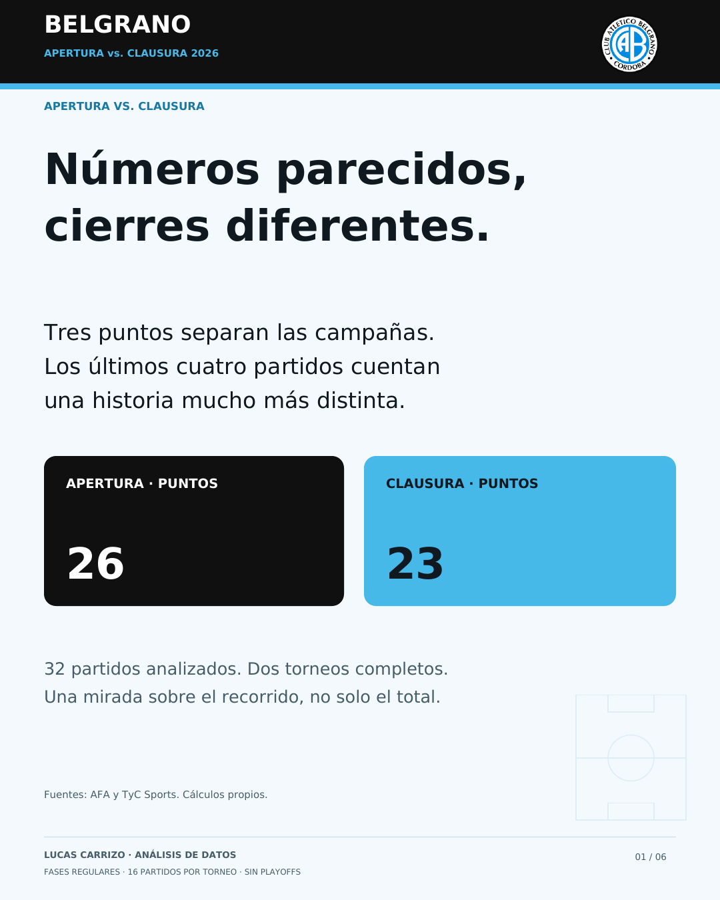

# Belgrano 2026: números parecidos, cierres diferentes

**Autor: Lucas Carrizo · Análisis de datos deportivos**

Comparé las fases regulares del Apertura y el Clausura 2026 de Belgrano de Córdoba para responder una pregunta: **¿dos campañas con resultados globales parecidos también tuvieron un recorrido parecido?**

Trabajé con 32 partidos y combiné resultados, remates, posesión y un recorte de delanteros. Organicé los datos en JSON, desarrollé su transformación y carga en SQLite con Python y presenté los hallazgos en un carrusel de seis filminas.



## Hallazgos

| Indicador | Apertura | Clausura |
|---|---:|---:|
| Partidos de fase regular | 16 | 16 |
| Puntos | 26 | 23 |
| Goles a favor | 17 | 17 |
| Goles recibidos | 13 | 15 |
| Puntos en los últimos cuatro partidos | 7 | 1 |
| Goles recibidos en los últimos cuatro | 1 | 8 |
| Remates recibidos en los últimos cuatro | 33 | 62 |
| Remates realizados en todo el torneo | 180 | 234 |
| Posesión promedio | 50,4% | 54,0% |

El Clausura llegó al partido 12 con tres puntos más que el Apertura, pero terminó con tres menos. En el cierre recibió 8 de sus 15 goles. El mayor volumen ofensivo del torneo —54 remates adicionales— convivió con la misma cantidad de goles a favor.

## Cómo recorrer el proyecto

- [Análisis y preguntas detrás de cada filmina](docs/ANALISIS.md).
- [Proceso de adquisición, transformación y carga](docs/PROCESO_DATOS.md).
- [Fuentes y criterios de selección](docs/FUENTES.md).
- [Metodología y diccionario de datos](METODOLOGIA.md).
- [Carrusel completo en PDF](informe/Belgrano_2026_analisis.pdf).
- [Consultas SQL](consultas.sql).

## Herramientas

Python automatiza los cálculos, las validaciones, la carga y las exportaciones. SQLite contiene la base analítica. Matplotlib y NumPy generan los gráficos, ReportLab compone las filminas y Poppler permite exportarlas a PNG. La lectura de documentos de LPF Data se apoyó en pdfplumber y en la inspección de sus páginas.

La adquisición fue una recopilación y transcripción controlada de fuentes públicas. Los scripts incluidos procesan esos archivos; no descargan automáticamente las páginas.

## Reproducir

Requisitos: Python 3.10 o superior, fuentes DejaVu Sans y, para exportar imágenes, Poppler.

```bash
python -m venv .venv
# Linux/macOS: source .venv/bin/activate
# Windows PowerShell: .venv\Scripts\Activate.ps1
python -m pip install -r requirements.txt
python src/construir_base.py
python src/crear_informe.py
pdftoppm -scale-to-x 1080 -scale-to-y 1350 -png informe/Belgrano_2026_analisis.pdf informe/lamina
```

El generador utiliza las fuentes DejaVu de `/usr/share/fonts/truetype/dejavu/` o de `recursos/fuentes/`. En Windows se pueden copiar `DejaVuSans.ttf` y `DejaVuSans-Bold.ttf` a esa última carpeta.

## Entregables

| Carpeta | Contenido |
|---|---|
| `datos/` | Insumos JSON, archivos derivados, CSV y base SQLite |
| `src/` | Procesamiento, validación y generación del informe |
| `graficos/` | Gráficos y escudo utilizado |
| `informe/` | PDF de seis páginas y PNG de 1080 × 1350 |
| `docs/` | Análisis, fuentes y proceso de datos |

Los CSV permiten explorar los datos en Excel u otras herramientas BI. Las fechas de consulta se conservan como metadatos de trazabilidad y no aparecen en las filminas.

## Alcance

El análisis cuantitativo compara fases regulares, sin playoffs ni copas. El título del Apertura aporta contexto al cierre editorial. Las diferencias son descriptivas: no prueban causas tácticas, responsabilidades individuales ni resultados futuros. El informe es independiente del club; el escudo identifica al equipo analizado.
